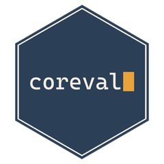

# coreval 

<!-- badges: start -->
[](https://CRAN.R-project.org/package=coreval)
[](https://github.com/hrach-gevorgyan/coreval/actions/workflows/R-CMD-check.yaml)
[](https://opensource.org/license/mit)
[](https://lifecycle.r-lib.org/articles/stages.html#stable)
<!-- badges: end -->

**Find out what's wrong with your SDTM, SEND or USDM data before you send it
anywhere.**

You've just written the code that builds a dataset. Normally you'd export it,
upload it to a validation tool, wait, and then work out which line of your code
caused each problem. coreval does the checking straight away, in R, on your own
machine. It tells you in plain words what's wrong, which rows, and what the
values were.

It runs CDISC's published conformance rules (CORE): CORE 1.0's rules for SDTM,
and CDISC's own for SEND, TIG and USDM. You'll still run your qualified tool
before you submit. You'll just arrive with far less for it to find.

## Try it

```r
install.packages("coreval")
library(coreval)

dm <- data.frame(
  STUDYID = "STUDY1",
  DOMAIN  = "DM",
  USUBJID = c("STUDY1-001", "STUDY1-002", "STUDY1-003"),
  RFSTDTC = c("2024-01-15", "2024-13-01", "2024-02-03"),  # month 13
  AGE     = c(34, 51, 47),
  AGEU    = c("YEARS", "YEARS", "")                       # age with no unit
)

result <- check_dataset(dm, standard = "SDTMIG", version = "3.4")
print(result, n = 2)   # describe the first two problems; typing `result` shows ten
```

You get a report like this:

```
── coreval — DM ────────────────────────────────────────────────────────────────

4 problems across 2 records  (143 checks ran)

  wrong value         2   the data breaks the rule - start here
  missing required    1   the standard requires it
  missing optional    1   often legitimate: not collected, screen failure, ...

[wrong value]
AGEU must be populated when AGE is populated.
  1 record · AGE, AGEU
    row 3  STUDY1-003  AGE = "47", AGEU = (empty)
    CORE-000189  · also CG0665, TIG0699

[wrong value]
Value must be a valid ISO 8601 datetime or interval.
  1 record · RFSTDTC
    row 2  STUDY1-002  RFSTDTC = "2024-13-01"
    CORE-002121  · also CG0011

  ... and 2 more here. See result$findings for all of them.

────────────────────────────────────────────────────────────────────────────────
69 checks could not run.
  28 need other datasets (AE, CE, DD, DS, EX, RELREC, ...)
     → run check_study() on the whole folder to cover these
  22 ask what the whole study contains
  13 need a define.xml
     → put it in the study folder (reading it needs the xml2 package)
  2 need to know the controlled terminology version
     → pass ct_package = "sdtmct-..." (see list_ct_packages()), or fill TSVCDREF and TSVCDVER in TS
  4 for other reasons, see result$skipped

Scoped to SDTMIG: 109 rules written for other standards, or other versions of this one, were not run.

Fix what you can, then run this again.
To track the rest:  write_findings(result, "issues.xlsx")
```

Both planted mistakes are found. Definite errors come first, and each one
shows the row, the subject (and the `--SEQ`, in a dataset that has
one) and the value. The rule number is at the end, with the
same rule's number in CDISC's Conformance Rules or the FDA Business Rules
after "also". The bottom part tells you
what it couldn't check and how to fix that.

## Everyday use

Three functions cover almost everything.

**While you write code**, check the data frame you just built, or a single
`.xpt`, `.sas7bdat` or `.csv` file:

```r
result <- check_dataset(ae, standard = "SDTMIG", version = "3.4")
```

**When the study exists as files**, check the whole folder. This is the only
way to run the rules that compare datasets with each other, such as an adverse
event date against the subject's dates in DM. A `define.xml` in the folder is
used automatically.

```r
result <- check_study("path/to/sdtm", standard = "SDTMIG", version = "3.4")
```

**To share with your team**, save an Excel workbook. It has the problems, what
couldn't be checked, and empty `Status`, `Owner` and `Notes` columns for
tracking who's fixing what.

```r
write_findings(result, "issues.xlsx")
```

## What the tags mean

| Tag | Means | What to do |
|---|---|---|
| `wrong value` | the data holds a value that breaks the rule, like a month of 13 | fix it first |
| `missing required` | something the standard requires is missing or blank | fix it |
| `missing optional` | something expected is missing | often fine for your study: check it applies |

To see only the definite errors: `filter_findings(result, triage = "wrong value")`.

## A clean report isn't always clean data

A short report can mean your data is fine, or that many rules couldn't run.
coreval never lets those look the same. Every result lists what it skipped and
why, in plain words: a dataset you didn't supply, no define.xml, no
Controlled Terminology version. If nothing could be checked at all, it stops
with an error rather than printing a clean report.

So before you celebrate, look at `result$skipped`.

## Common questions

**Which terminology version does it use?** The one your study declares, in TS
(`TSVCDVER`, with `TSVCDREF` = `CDISC`) or in the define.xml. If neither says, the terminology rules are
skipped until you tell it, for example `ct_package = "sdtmct-2026-03-27"`.
`list_ct_packages()` lists every release. It never guesses.

**What does a rule check?** `list_rules(id = "CORE-000189")` gives its
description, the guidance it comes from and its Conformance Rules numbers.

**Does my data leave my computer?** No. There's no internet access, account or
API key. The rules and terminology are bundled in the package.

**Can I make my program stop when a dataset has errors?** Yes, see "Stop my
program when a dataset has errors" in `vignette("coreval")`.

**Is it a replacement for Pinnacle 21 or CDISC's engine?** No. It's the quick
check you run while working. Use a qualified tool for the submission.

## Install

```r
install.packages("coreval")
```

The development version, with changes not yet on CRAN, is on GitHub:

```r
# install.packages("pak")
pak::pak("hrach-gevorgyan/coreval")
```

It needs R 4.1 or newer. A few optional packages switch on more, and coreval
tells you when something was skipped because one is missing:

```r
install.packages(c("xml2", "writexl", "jsonlite", "QuickJSR"))
```

`xml2` reads define.xml, `writexl` saves to Excel, and `jsonlite` and
`QuickJSR` read USDM study files.

## What it covers

- **1,184 rules**: 621 CORE 1.0 rules for SDTMIG 3.2 to 3.4 and the FDA
  Business Rules, maintained by Verisian in
  [core-contributor](https://github.com/verisianHQ/core-contributor), and
  CDISC's rules for SEND, TIG and USDM from
  [cdisc-open-rules](https://github.com/cdisc-org/cdisc-open-rules). Retired
  rules are included but run only if you ask.
- **Files**: XPT, SAS datasets, CSV, Dataset-JSON, Define-XML, and USDM study
  files with `usdm = TRUE`.
- **Every Controlled Terminology release** CDISC has published, bundled.

Both rule sets ship worked examples, and coreval is tested against every one.
More than nine in ten rules give exactly the expected answer;
[docs/COVERAGE.md](https://github.com/hrach-gevorgyan/coreval/blob/master/docs/COVERAGE.md)
explains each of the rest.

**Not yet:**

- **ADaM.** CDISC publishes no worked examples for its ADaM rules, so there's
  no way to show they'd be right.
- **Medical dictionaries.** It can't check terms against your licensed MedDRA
  or WHODrug.

## How it compares

coreval is an independent implementation of the same rules that CDISC's engine
and Verisian's CORE 1.0 engine run. On CDISC's complete pilot study it agreed
with Verisian's engine on almost every rule, and each difference has a traced
cause. It runs inside R, offline, and in a fraction of the time and memory. The
engines are the official reference and can check medical dictionaries.
[docs/COMPARISON.md](https://github.com/hrach-gevorgyan/coreval/blob/master/docs/COMPARISON.md)
goes through it all.

## Learn more

- **Getting started:** `vignette("coreval")`. Four steps, then answers to
  common tasks: only the real errors, choosing your standard, terminology,
  big studies.
- **How it works:** `vignette("technical")`. The full reference: which files
  are read, which rules run and why, every skip reason, every column of a
  result.
- **Help for each function:** `?check_dataset`, `?check_study`,
  `?write_findings`, `?filter_findings`, `?list_rules`, `?list_ct_packages`,
  `?read_study`.
- **The evidence:** [docs/](https://github.com/hrach-gevorgyan/coreval/tree/master/docs)
  has a real study checked by coreval and the reference engine, rule
  coverage, speed benchmarks and design decisions.

## Please read this

coreval is an independent, personal open-source project. It is **not** a CDISC
product, not endorsed by CDISC, and not a certified CORE engine. It is not
validated software. A clean result doesn't mean a submission will be accepted,
and it doesn't replace your organisation's own validation.

Found a wrong or missing result? That's the most useful thing you can report.
[Open an issue](https://github.com/hrach-gevorgyan/coreval/issues), ideally
with a small dataset that shows it. Please read the
[Code of Conduct](https://github.com/hrach-gevorgyan/coreval/blob/master/CODE_OF_CONDUCT.md)
first.

## License

The package code is MIT. The bundled rules and standards data come from three
MIT-licensed repositories: CDISC's
[cdisc-open-rules](https://github.com/cdisc-org/cdisc-open-rules) and
[cdisc-rules-engine](https://github.com/cdisc-org/cdisc-rules-engine), and
Verisian's [core-contributor](https://github.com/verisianHQ/core-contributor),
which holds the CORE 1.0 SDTM rules. Two other bundled pieces carry their own
permissive licences: the W3C's XHTML schemas, used to check narrative text in
USDM files, and IBM's JSONata, used to run some USDM rules. Every bundled file,
where it came from and its licence are listed in `inst/COPYRIGHTS`.

CDISC, CORE, SDTM, SEND, ADaM, Define-XML and TIG are trademarks of the
Clinical Data Interchange Standards Consortium, used here only to name the
standards this package reads.
